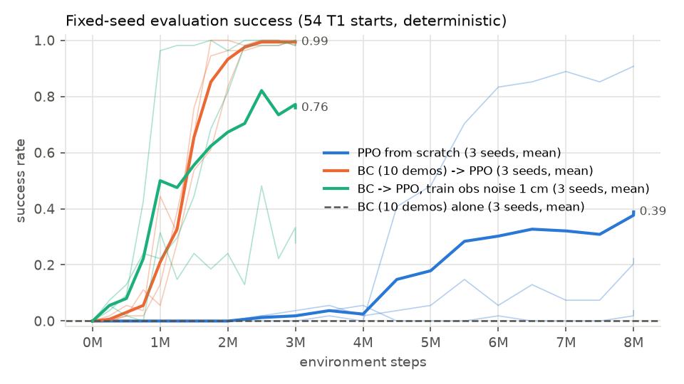
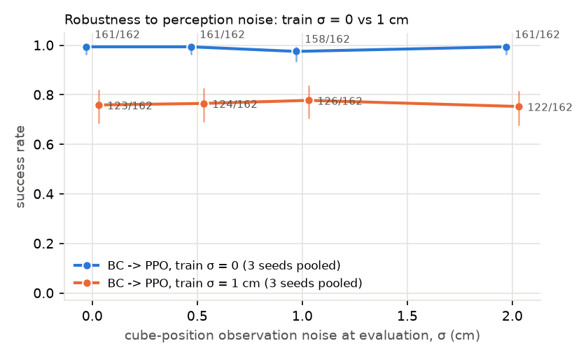
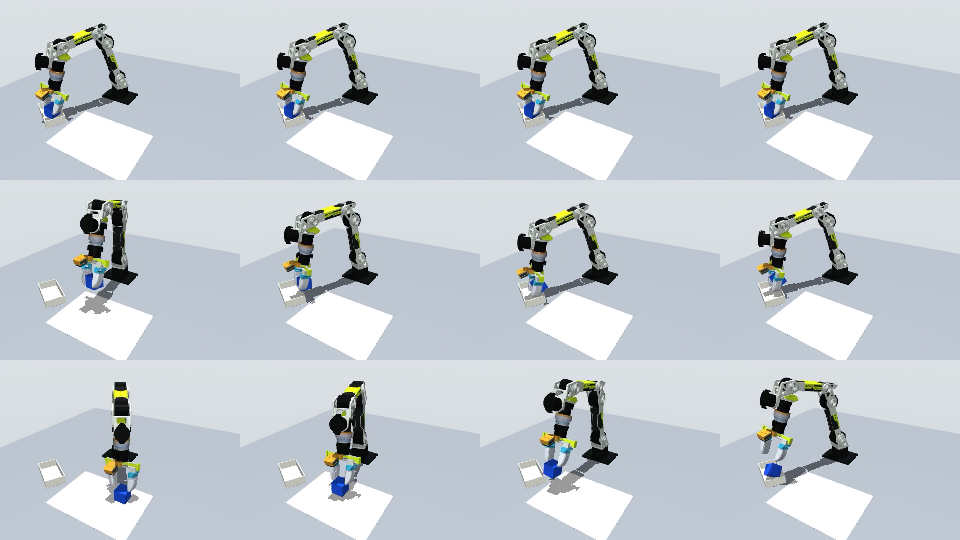

# rebot-sim-rl: RL and imitation in a MuJoCo twin of the reBot B601-RS T1 task

State-based reinforcement learning, behaviour cloning, and BC→RL fine-tuning on a
simulated version of the real-robot task *T1: pick up the ~6 cm blue foam cube and
place it in the white lunch box* (reBot `t1_pick_place_v1`). Everything here is
**simulation only**. None of these policies has been run on the real arm.

## Results at a glance

All numbers: deterministic policy, **54 fixed T1 starts** per checkpoint (9 mat
points × yaw {0°, 45°} × 3 placement jitters), 3 training seeds per condition,
pooled counts with 95% Wilson intervals. Reward version 2 unless noted.

| Policy | Env steps | Success (cube in box, released) | Careful placement* |
|---|---|---|---|
| Scripted IK expert (privileged) | – | 54/54 | 48/54 |
| BC, 10 scripted demos | – | **0/162** (0–2%) | 0/162 |
| PPO from scratch | 8M | **63/162** (39%, 32–47%); seeds 2, 49, 12 | 21/162 (13%) |
| BC (10 demos) → PPO fine-tune | 3M | **161/162** (99%, 97–100%); seeds 54, 54, 53 | **13/162 (8%)** |
| BC → PPO, train obs noise 1 cm (ablation) | 3M | 123/162 (76%, 69–82%); seeds 54, 15, 54 | 29/162 (18%) |
| BC → PPO, reward v3 (only careful placement counts) | 3M | 25/162 (15%, 11–22%); seeds 2, 10, 13 | 12/162 (7%, 4–13%) |

\*Careful placement: at release the cube centre is ≤ 8 cm high (its bottom about at
the 4.5 cm box rim) and moves horizontally ≤ 0.2 m/s. The real T1 protocol lowers
the cube into the box before opening.



What the experiments show:

1. **IL + RL beats either alone in this setting.** BC from 10 demos never succeeds
   (it grasps and carries, then does not release); PPO initialised from it
   (critic-only warmup 200k steps, log-std −1) reaches ≥ 50/54 after 1.75–2.25M
   steps on all three seeds. PPO from scratch is slow and seed-dependent: one seed
   learned to release at ~4.5M steps (49/54 at 8M), two stayed at 2/54 and 12/54.
2. **Return rises while success does not.** With reward v1, PPO's training return
   climbed from 12 to 68 per episode in 1M steps at 0% success: it learned to grasp
   and hold, because the transport term was flat far from the box
   (`results/figures/pilot_reward_v1_*.png`). Even with v2, scratch PPO spends
   millions of steps carrying the cube to the box and holding it there; releasing
   costs the grasp and transport reward before the success bonus arrives.
   Training return and success are plotted separately
   (`main_train_return.png`, `main_train_success.png`, `main_eval_success.png`).
3. **The success metric was gamed.** Reward-v2 policies let go while still moving,
   from up to 20 cm (median 8.9 cm): BC→PPO's 161/162 "successes" contain only 13 careful
   placements. The success test only checks where the cube ends up.
   **Tightening the success test alone did not fix it.** Reward v3 (same shaping,
   success and its bonus only for a careful placement) removed the shortcut but
   BC→PPO then mostly carried the cube and held it: 12/162 careful placements after
   3M steps, no better than v2 (`results/figures/v3_*.png`). A shaping term for
   lowering into the box mouth (or demos that do it) is the next thing to try;
   not done here.
4. **Domain-randomisation ablation (single factor: cube-position observation noise,
   i.i.d. Gaussian per step) found no benefit.** Policies fine-tuned without noise
   kept 158–161/162 at evaluation noise up to σ = 2 cm; training with σ = 1 cm did
   not improve that and one of its three seeds did not converge (15/54). The
   scratch-PPO seed that did learn is noise-sensitive (49 → 33/54 at σ = 2 cm).
   I.i.d. noise is a weak test; a per-episode bias (a miscalibrated detector) is
   the obvious next factor.

   

5. **BC data scaling** (scripted demos, 3 seeds each): 5 demos 1/162, 10 demos
   0/162, 20 demos 111/162, 50 demos 146/162 (`results/figures/bc_scaling.png`).

Failure modes (`results/videos/`, first failures of each model at σ = 0):
scratch PPO holding the cube inside the box mouth without releasing (top), BC
carrying the cube to the box but never opening (middle); bottom: a BC→PPO "success"
that lets go while still moving.



### LIBERO with public checkpoints (`results/libero/`)

LeRobot `lerobot_eval`, 10 episodes per task, 10 tasks per suite, official
checkpoints, one H100, H200 or L40S GPU per job (`cluster/libero_eval.sbatch`, details in `results/libero/RUNS.md`). π0.5 used
`n_action_steps=10` and `compile_model=false`.

| Policy | Suite | Ours (n/N, 95% CI) | Published |
|---|---|---|---|
| SmolVLA `HuggingFaceVLA/smolvla_libero` | Spatial | 82/100 (73–88%) | 90 (SmolVLA 0.45B, paper Table 2) |
| | Object | 95/100 (89–98%) | 96 |
| | Goal | 73/100 (64–81%) | 92 |
| | Long (libero_10) | 45/100 (36–55%) | 71 |
| π0.5 `lerobot/pi05_libero_finetuned` | Spatial | 99/100 (95–100%) | 97 (LeRobot) / 98.8 (OpenPI) |
| | Object | 100/100 (96–100%) | 99 / 98.2 |
| | Goal | 100/100 (96–100%) | 98 / 98.0 |
| | Long (libero_10) | 100/100 (96–100%) | 96 / 92.4 |

π0.5 matches or slightly exceeds the published numbers (within the 100-episode intervals).
SmolVLA averages 73.8% over the four suites against 87.3% in its paper: Object
matches, while Spatial (−8), Goal (−19) and Long (−26 points) fall outside our
intervals. Third-party SmolVLA baselines land close to ours (RetoVLA, arXiv
2509.21243: 75.8 / 70.8 / 80.4 / 50.4; SMILE, arXiv 2608.29432: 42.8 on Long). Not
investigated: the public checkpoint may differ from the paper's model, and the
seeds/initial states differ. Long was run as five 2-task shards
(`smolvla_libero_10_shard*.eval_info.json`) because one L40S job would have
exceeded its time limit.


## The simulated task

| | Simulation | Real T1 (reBot) |
|---|---|---|
| Arm | upstream B601-RS MJCF kinematics, inertias and meshes; joint ranges clipped to the real software limits of control profile 08 (relative to the profile reference zero) | B601-RS, profile `b601_px6d_w2l_wide_open_20261016_08` |
| Tool | primitive PX6D + R8 + W2L model: 24 cm flange-to-fingertip, parallel gap 0–8.4 cm, 30 N grip limit | PX6D-75 + R8 + two DM-Tac W2L fingers, 24 cm (tape), 8.4 cm max gap |
| Control | 10 Hz Cartesian delta (2 cm, 0.15 rad yaw) → damped-least-squares IK → joint targets (limit-clipped, 1 rad/s) → force-limited joint PD with gravity compensation | 50 Hz joint-position mirror of a leader arm (teleop); policies output joint positions at 30 Hz |
| Observation | 38-d state: joints, TCP pose, cube pose, box offset, finger contacts, last action | two RGB cameras + joint state (no cube pose) |
| Starts | cube anywhere in the 9-point mat frame (±1.5 cm), yaw 0–90°; evaluation on the 9 printed points × yaw {0°, 45°} × 3 placement jitters (±1 cm) = **54 fixed episodes** | same 9 points × yaw {0°, 45°} |
| Success | cube centre inside the box's inner footprint, below 6 cm, not touched by the fingers | cube in the box and released |

Positions come from the measured T1 layout (mat 12 cm to the arm's left, cross
~40 cm forward, box centre ~(38, −22) cm), see `configs/t1_layout.json`.

### How close is the sim arm to the real one? (`results/model_check/`)

Replaying the joint traces of 40 recorded real T1 demonstrations through the sim
kinematics (offline, read-only):

- At the moment the operator starts closing the gripper, the simulated TCP lies a
  median **2.3 cm** (p90 3.4 cm) from the planned cube cell. The cells themselves are
  only known to about ±2 cm, so this bounds rather than measures the model error.
- The simulated fingertip is **0.7–2.6 cm above the table** at those grasps (median
  1.8 cm): joint zeros, signs and the 24 cm tool length are consistent.
- No recorded sample lies outside the sim joint ranges.
- The real tool is tilted a median 12° from vertical at grasp. The sim confirms why:
  with the real J4 lower limit (−1.365 rad) a vertical tool is infeasible over most
  of the workspace, so the sim IK also tilts the tool outward (12° at table height,
  more when higher).
- The finger gap while holding the 6 cm cube maps to a median 4.75 cm with the
  linear J7 calibration: either the foam is squeezed or the near-closed gap is not
  zero (profile 08 notes it may not be). Unresolved; see `sim2real/PROTOCOL.md`.

### MDP details

- Reward (version 2, dense, ≤ 1 per step): reach 0.2 · (1 − tanh 10d), grasp +0.2,
  lift +0.1, transport +0.4 · (1 − tanh 3d) toward a point 10 cm above the box, cube
  in box 0.9. Success ends the episode and pays 1 per remaining step, so finishing
  early is never worse than holding a high-reward state.
- 150 steps (15 s) per episode; termination on success or if the cube leaves the table area.
- Version 1 of the reward used a transport term 1 − tanh 5d (flat about 40 cm from
  the box) and no lift term; it is kept as `--reward-version 1` for the pilot below.
- Version 3 (`--reward-version 3`) keeps the v2 shaping but grants success only for a
  careful placement (cube centre ≤ 8 cm and horizontal speed ≤ 0.2 m/s at release).

## Reproduce

```bash
conda env create -f environment.yml          # torch cu128 build for the RTX PRO 2000 (sm_120)
tools/fetch_meshes.sh                       # STL meshes from the public upstream repo, sha256-checked
export PYTHONPATH=$PWD
python tools/build_scene.py                 # regenerate assets/b601/b601_t1_scene.xml
python scripts/check_model.py               # sim kinematics vs the recorded real joint traces in data/
bash experiments/bc_scaling.sh              # demos + BC, 4 demo counts x 3 seeds
# PPO / BC->PPO / ablation: one line per run in experiments/main_j*.cmds
python scripts/train_rl.py --algo ppo --steps 8000000 --eval-every 500000 --lr 3e-4 --n-envs 8 --seed 0 --out runs/main/ppo_scratch_s0
python scripts/evaluate.py --model checkpoints/bcppo_n10_s0/model_last.zip --obs-noise 0 0.005 0.01 0.02 --out results/eval/bcppo_n10_s0.json
# figures from the committed curves (results/runs/) without retraining:
python scripts/plot_results.py --group "PPO from scratch=results/runs/main/ppo_scratch_s*" \
    --group "BC (10 demos) -> PPO=results/runs/main/bcppo_n10_s?" --bc-ref "results/runs/main/bc_n10_s*" \
    --out results/figures --prefix main_
```

Compute used: the main sweep (`experiments/main_j*.cmds`, 9 runs) ran on NVIDIA A40 GPUs
with 16 CPU cores per job, the reward-v3 runs (`experiments/v3_s*.cmds`) on an H200, about
1.3k environment steps/s per 8-env run; BC, demos and evaluation ran on a laptop
(at most 3 low-priority processes). `cluster/rl_train.sbatch` runs a `.cmds` file on
one GPU slice; `cluster/libero_eval.sbatch` runs one LIBERO suite (or task shard),
see `results/libero/RUNS.md`.

## Limitations

- **Simulation is not the real robot.** The tool and cube are boxes; foam
  compliance, cube mass and friction are guesses; there is no camera, no
  latency and no leader-arm teleoperation; the controller is an ideal joint PD.
  The sim policies see the true cube pose, which the real robot does not have.
- **Different action interface.** The sim agent acts through Cartesian deltas and
  IK; the real policies output joint positions. Only joint-space kinematics have
  been checked against the real arm (above), not dynamics or contact.
- **No real-robot RL.** Nothing here was executed on hardware. The prepared
  touch-point check in `sim2real/` has not been run.
- **Scripted demonstrations.** BC demos come from a privileged scripted IK expert,
  not from human teleoperation, so the BC numbers are not comparable to the real
  ACT / SmolVLA / π0.5 results in
  [rebot-il-vla-benchmark](https://github.com/bowenszhu/rebot-il-vla-benchmark).
- Seeds: 3 per condition; evaluation is 54 deterministic episodes per checkpoint.

## License

Code: Apache-2.0 (`LICENSE`). Results, configs and the recorded joint traces: CC BY 4.0.
The B601-RS model files come from a third-party public repository and are not covered by
either licence; see `NOTICE` and `assets/b601/PROVENANCE.md`.
